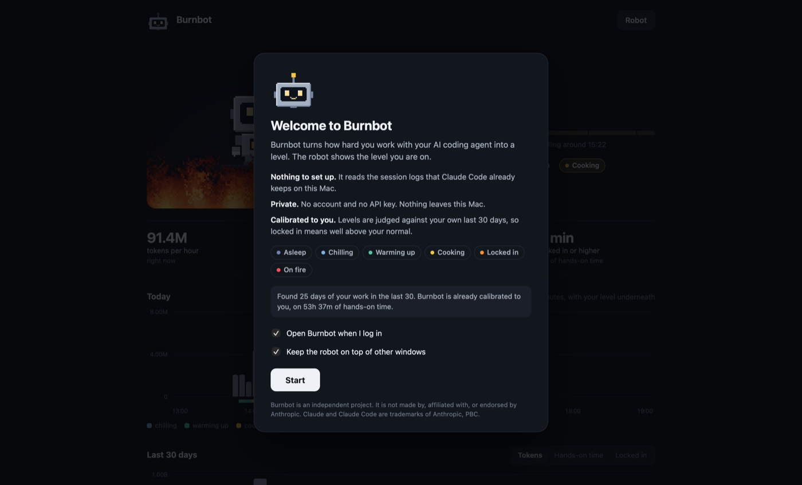
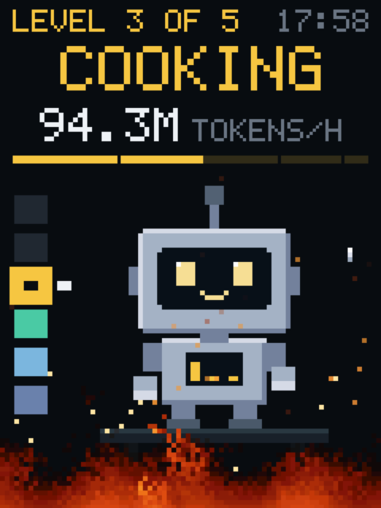

# Burnbot

Burnbot turns how hard you work with your AI coding agent into a level:
asleep, chilling, warming up, cooking, locked in, on fire. A small steel robot
shows the level you are on, its face glowing in the level's colour, standing
in a fire that burns higher the more tokens you burn.

The levels are calibrated to you. "Locked in" means well above your own
normal, whatever your normal is.

It works with Claude Code. Burnbot is an independent project: it is not made
by, affiliated with, or endorsed by Anthropic.


## Install

1. Download `Burnbot-1.0.zip` from the [Releases page](https://github.com/megamind-rgb/burnbot/releases).
2. Unzip it and drag **Burnbot** into Applications.
3. Open it.

This build is not yet notarized by Apple, so the first time macOS will say it
cannot check the app. Go to **System Settings > Privacy & Security**, scroll
down, and click **Open Anyway**. (On macOS 14 and earlier: right-click the app
and choose Open.) You only do this once.

It needs macOS 13 or newer, on Apple Silicon or Intel, and Claude Code used
on the same Mac. There is nothing else to install, no account, and no API key.

## What happens when you open it

A welcome screen explains what it does and what it found on your Mac.



After that there are two windows:

- **The robot.** A small window in the bottom-right corner that stays on top
  of everything, including fullscreen apps, on every desktop. It shows your
  level and tokens per hour. Make it bigger and it also shows the whole
  ladder, today's burn and what the next level takes. Drag it anywhere; it
  remembers. Double-click it to fill the screen.
- **The dashboard.** Your level and the ladder, four numbers, a timeline of
  today with your level under it, and the last 30 days. Two folded sections
  hold the rest: why you are on this level, and the detail (typing, code
  written, a weekday-by-hour heatmap, tokens by project, every day as a table).

Plug in a second monitor and the robot moves there and goes fullscreen by
itself; unplug it and the robot comes back to its corner.

If you have never used Claude Code on this Mac, the robot sleeps and the
dashboard says so. Use Claude Code and it wakes up on its own.

| Robot menu | Shortcut |
|---|---|
| Show Dashboard | ⌘1 |
| Show Robot | ⌘2 |
| Robot on the Second Screen | ⌘3 |
| Robot in a Window | ⌘4 |
| Keep Robot on Top | ⌘T |
| Full Screen | ⌃⌘F |

**Open at Login** and the welcome screen are in the Burnbot menu.

## The levels

| Level | Name | When |
|---|---|---|
| 0 | Asleep | No activity for 30 minutes |
| 1 | Chilling | Quiet for 5 minutes |
| 2 | Warming up | Working, in your quietest 30% |
| 3 | Cooking | Above your quietest 30%: your usual working pace |
| 4 | Locked in | Your top 25%, after 20 minutes of unbroken work |
| 5 | On fire | Your top 7% |
| A | Autopilot | Off the ladder: the AI is still working but you have gone longer without a prompt than you usually do |

## It calibrates itself

No level is tied to a fixed amount of tokens or typing. Every couple of
seconds Burnbot looks at your last 30 days and works everything out again:

1. **Three signals, each ranked against you.** A value is scored by how much
   of your own hands-on time it beats.

   | Signal | Weight | Source |
   |---|---|---|
   | Burn | 40% | Tokens per hour: everything the model read and wrote, cached context included |
   | Typing | 35% | Characters you typed into your prompts. Pasted text and system messages are left out |
   | Actions | 25% | Your prompts plus the tool calls the AI made |

2. **Intensity, ranked against you again.** The blend of the three is ranked
   against your own hands-on time once more, so intensity 75 always means
   "hotter than 75% of your time". The levels are cut on that scale, which is
   why locked in is your top quarter whether you burn 5M tokens an hour or 500M.
3. **Autopilot timing from your rhythm.** It starts after the gap you leave
   between prompts 85% of the time (kept between 15 and 60 minutes).
4. **Your usual level for the hour** comes from the level you reached around
   that time on your past working days.

Old days fall out of the 30-day window, so the levels drift with you. Until
Burnbot has seen two hours of your work it uses starter values and says it is
still calibrating.

## Privacy

Burnbot reads the session logs Claude Code already writes on your Mac, in
`~/.claude/projects`. It makes no network connections. Its own history is
kept in `~/Library/Application Support/Burnbot`, so it survives when Claude
Code clears old logs, and a log in `~/Library/Logs/Burnbot.log`.

## How accurate it is

Token totals match an independent recount of the logs exactly, day for day.
You can run that check yourself:

```bash
python3 tools/audit.py
```

Three limits come from what Claude Code writes to its logs, not from Burnbot:

- **Agent output before November 2026.** Claude Code versions before 2.1.317
  logged subagent responses without their final output counts, so output
  tokens are low for those days (about half was missing in testing). Total
  tokens are barely affected, because output is a tiny share of them.
- **Small background requests** (session titles, safety checks) are not
  logged: roughly 0.2% of tokens.
- **Claude Code only.** Chats on claude.ai are not on your Mac's disk.

## The desk screen (optional hardware)

A small screen of its own for the robot: a Seeed XIAO nRF52840 (Sense or
Sense Plus) with a 2.4" 240 × 320 SPI display (ILI9341), plugged in by USB.



| Display | VCC | GND | DIN | CLK | CS | DC | RST | BL |
|---|---|---|---|---|---|---|---|---|
| XIAO | 3V3 | GND | D10 | D8 | D0 | D1 | D2 | D6 |

It shows the level and its number, tokens per hour, an intensity bar with a
notch where each level begins, and the robot in its fire with the level
ladder beside it.

Burnbot finds the board by itself and tells it your level once a second; the
board keeps the fire and the robot moving in between. The dashboard shows
"Desk screen on" when it is answering, with a **Flip** link if the picture is
upside down. A board running another program is left alone.

To put the program on the board: quit Burnbot, plug the board in, and
double-click `desk/Upload to the screen.command`. It needs `arduino-cli`
(`brew install arduino-cli`).

To see a screen without the board:

```bash
c++ -std=c++11 -O2 -I desk/burnbot_screen desk/tools/sim.cpp -o /tmp/burnbot-sim
/tmp/burnbot-sim /tmp/screen.bmp 'B|s=4|lv=4|tp=5|u=3|i=81|f=78|nm=LOCKED IN|cp=LEVEL 4 OF 5|rt=71.2M|tm=17:29'
open /tmp/screen.bmp
```

## Building it yourself

```bash
./build-app.sh
```

This needs Xcode's Swift compiler and nothing else. It makes `Burnbot.app`
(Apple Silicon and Intel) and `dist/Burnbot-<version>.zip`. With a Developer
ID certificate in your keychain it signs with it, and with
`NOTARY_PROFILE=<name>` it also notarizes, which removes the "Open Anyway"
step for people who download it.

### Working on the screens

The dashboard and the robot window are the pages in `public/`. Point the app
at that folder and it loads them from there, so you can edit and press ⌘R
instead of rebuilding:

```bash
open Burnbot.app --args --pages "$PWD/public"
```

Level names and colours are in `STATE_META` at the top of `public/robot.js`,
and the robot is drawn by `drawRobot` in the same file. The desk screen picks
the names up from there, and has its own copy of the robot and colours in
`desk/burnbot_screen/render.h`. The level cut-offs and time
limits are in `Config` at the top of `app/Metrics.swift`.

Other options, mostly for testing:

| Option | What it does |
|---|---|
| `--fresh` | Behave like a first launch: no saved history, show the welcome |
| `--root <folder>` | Read session logs from here instead of `~/.claude/projects` |
| `--background` | Start without taking the focus (use with `open -g`) |
| `--snapshot <folder>` | Write a picture of each window a few seconds after start |
| `--dump-state <file>` | Write what the tracker sees as JSON and quit |

A window that is completely covered is not animated by macOS, so its picture
comes out without the robot, the fire and the big numbers.

### Files

```
app/main.swift        windows, menus, second screen, talking to the pages
app/Tracker.swift     reads and tails Claude Code's session logs
app/Metrics.swift     baseline, intensity, levels
app/DeskScreen.swift  finds the desk screen on USB and feeds it
app/Pages.swift       serves the pages to the app's own windows
public/               the dashboard and the robot window
desk/                 the desk screen's own program, its simulator and upload command
tools/audit.py        independent recount of the tokens
tools/make-icon.mjs   redraws the app icon from the robot (needs Node.js)
```

## Names and trademarks

Burnbot is an independent project. It is not made by, affiliated with, or
endorsed by Anthropic. Claude and Claude Code are trademarks of Anthropic,
PBC; they are named here only to say what Burnbot works with. Burnbot's name,
robot, icon and colours are its own.
