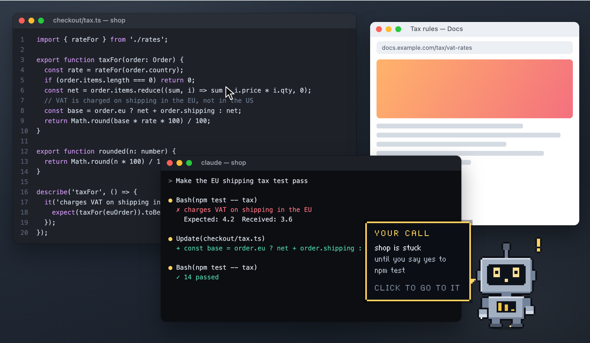
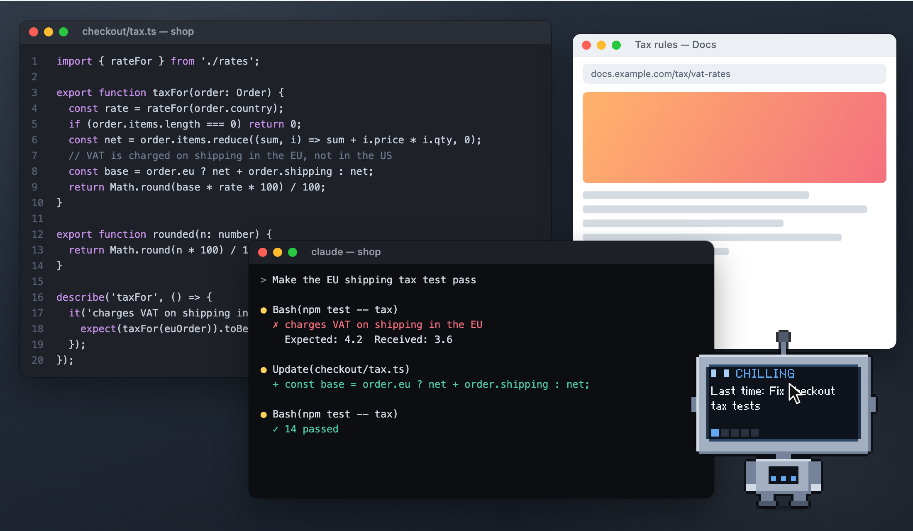
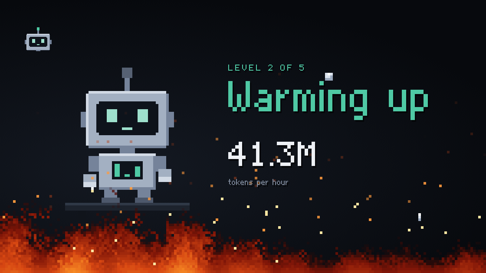
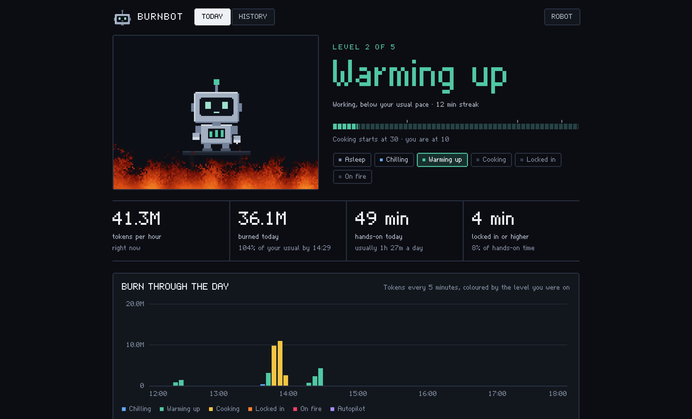
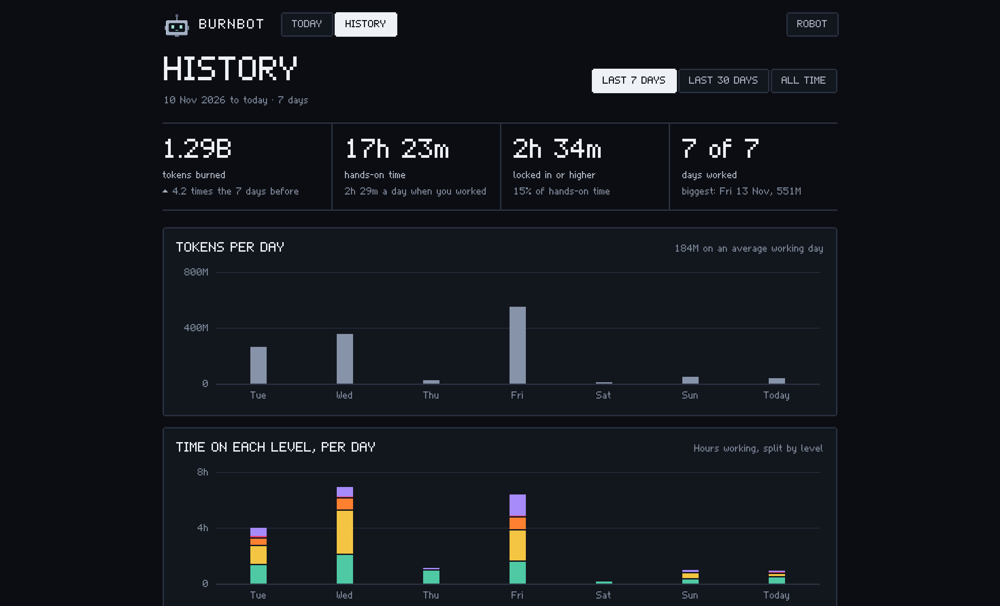
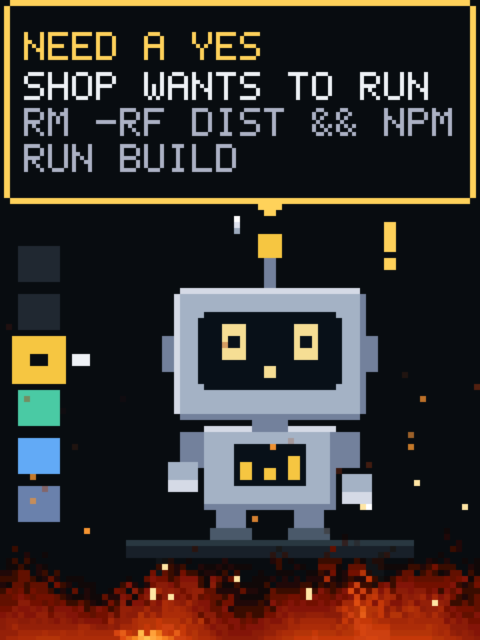

# Burnbot

Burnbot turns how hard you work with your AI coding agent into a level:
asleep, chilling, warming up, cooking, locked in, on fire. A small steel robot
stands on your desktop and shows the level you are on: its face glowing in the
level's colour, its arms tapping faster, a little fire at its feet the more
tokens you burn, and at the top, flames on its head and smoke out of its ears.
All of it is pixel art, down to the letters.

The levels are calibrated to you. "Locked in" means well above your own
normal, whatever your normal is.

The robot also notices a few things worth knowing, and keeps quiet about the
rest: a worried face when a test run fails, a cheer when it finally passes, a
word when Claude needs you and you are not looking, and a short recap when a
session is over.

It works with Claude Code. Burnbot is an independent project: it is not made
by, affiliated with, or endorsed by Anthropic.











## Install

1. Download the newest `Burnbot` zip from the [Releases page](https://github.com/megamind-rgb/burnbot/releases).
2. Unzip it and drag **Burnbot** into Applications.
3. Open it.

This build is not yet notarized by Apple, so the first time macOS will say it
cannot check the app. Go to **System Settings > Privacy & Security**, scroll
down, and click **Open Anyway**. (On macOS 14 and earlier: right-click the app
and choose Open.) You only do this once.

It needs macOS 13 or newer, on Apple Silicon or Intel, and Claude Code used
on the same Mac. There is nothing else to install, no account, and no API key.

## What happens when you open it

A welcome screen explains what it does and what it found on your Mac.


After that there are two windows:

- **The robot**, standing in the bottom-right corner of your desktop with
  nothing around it: no window, no backdrop. It stays on top of everything,
  including fullscreen apps, on every desktop, and clicks pass straight
  through the space around it. At rest it says nothing; its face, its arms
  and the little fire or embers around it show the level.
  - **Point at it** and its face turns into a small screen: the level, what
    Claude is doing, and an intensity bar. Move away and its eyes come back.
    Pick how: **Big** (the head grows, with tokens per hour), **Wide** (a
    strip with the eyes at one end, the least height) or **Compact** (a
    smaller head with a thin frame, the least room).
  - **Click it** and it tells you, in a panel beside its head with a speech
    bubble's tail: the session you are on, what Claude is
    doing in it, your level, and the one thing to do next ("Approve npm test
    in shop", "Reply to Claude in shop", "Tests still failing in shop"), with
    a **Go to it** button when Claude needs you. Click it again or click
    elsewhere to close it; left alone, it closes after 20 seconds.
  - **Drag it** anywhere; it remembers. Its screen, bubbles and panel always
    open toward the middle of the screen, so any corner works.
  - **Flick it** with two fingers on the trackpad, pointer on the robot, and it
    slides one spot the way your fingers went. The spots are the corners and the
    middle of each edge, just in from the edge. Flick right at the top left and
    it goes to the top middle; flick again and it reaches the top right, where
    another flick right leaves it be. A slow scroll over it does nothing.
  - **Right-click it** for its size (Small, Medium, Large), its hover screen,
    Keep on Top, the second screen and Hide.
- **The dashboard**, in two pages.
  - **Today** starts with your level and the ladder, then four numbers, then
    today's graphs: tokens through the day coloured by level, today against
    your usual day, the time spent on each level, and the three signals that
    set your level right now.
  - **History** covers the last 7 days, the last 30, or everything on record:
    tokens per day, hours on each level per day, where the time went, tokens
    by project, and every day drawn hour by hour.

Plug in a second monitor and the robot moves there and goes fullscreen by
itself, in its whole scene: the fire, the level ladder, today's burn and what
the next level takes. Unplug it and the robot comes back to your desktop.

If you have never used Claude Code on this Mac, the robot sleeps and the
dashboard says so. Use Claude Code and it wakes up on its own.

| Robot menu | Shortcut |
|---|---|
| Show Dashboard | ⌘1 |
| Show Robot | ⌘2 |
| Robot on the Second Screen | ⌘3 |
| Robot on the Desktop | ⌘4 |
| Robot Size ▸ Small, Medium, Large | |
| Hover Screen ▸ Big, Wide, Compact | |
| Keep Robot on Top | ⌘T |
| Full Screen | ⌃⌘F |

**Open at Login** and the welcome screen are in the Burnbot menu.

## The levels

| Level | Name | When |
|---|---|---|
| 0 | Asleep | No activity for 30 minutes |
| 1 | Chilling | Quiet for 5 minutes. Reading a plan or a question Claude put to you does not count as quiet: while you are at the Mac with one open, you are still working |
| 2 | Warming up | Working, in your quietest 30% |
| 3 | Cooking | Above your quietest 30%: your usual working pace |
| 4 | Locked in | Your top 25%, after 20 minutes of unbroken work |
| 5 | On fire | Your top 7%. Flames on its head, smoke out of its ears |
| A | Autopilot | Off the ladder: the AI is still working but you have gone longer without a prompt than you usually do |

## It calibrates itself

No level is tied to a fixed amount of tokens or typing. Every couple of
seconds Burnbot looks at your last 30 days and works everything out again:

1. **Three signals, each ranked against you.** A value is scored by how much
   of your own hands-on time it beats.

   | Signal | Weight | Source |
   |---|---|---|
   | Burn | 40% | Tokens per hour: everything the model read and wrote, cached context included |
   | Typing | 35% | Characters you typed into your prompts. Pasted text and system messages are left out |
   | Actions | 25% | Your prompts, your answers (to Claude's questions, plans and permission asks), and the tool calls the AI made |

2. **Intensity, ranked against you again.** The blend of the three is ranked
   against your own hands-on time once more, so intensity 75 always means
   "hotter than 75% of your time". The levels are cut on that scale, which is
   why locked in is your top quarter whether you burn 5M tokens an hour or 500M.
3. **Autopilot timing from your rhythm.** It starts after the gap you leave
   between prompts 85% of the time (kept between 15 and 60 minutes).
4. **Your usual level for the hour** comes from the level you reached around
   that time on your past working days.

Old days fall out of the 30-day window, so the levels drift with you. Until
Burnbot has seen two hours of your work it uses starter values and says it is
still calibrating.

## What the robot notices

Most of the time the robot just shows your level. Now and then it reacts,
and only when there is good reason to:

| Moment | What it sees | What it does |
|---|---|---|
| A run failed | A test, build or type check Claude ran came back failing | A worried face for a few seconds, if you are at your terminal or editor |
| Quick fix | The same kind of run passes after failing once, quickly | A small smile for a couple of seconds, no words. A run that passes with nothing red before it gets nothing at all |
| Breakthrough | The same kind of run passes after failing twice, or after five minutes in the red, with a clean exit and nothing in the output that says it failed | A happy face and "Finally. All green." (or "It builds", "Types check"). After four tries or ten minutes in the red, a cheer: a hop and more sparks |
| Waiting on you | Claude Code asks permission for something | If you are in your terminal or editor, a face; if you are elsewhere, a bubble that stays until you are back. Click it to go to your terminal |
| Your move | Claude stops after working for two minutes or more | A bubble, only if you are elsewhere |
| Session over | The session ends, or goes quiet for 30 minutes after at least 20 minutes of work | A recap: how long, what went green, commits and pull requests |
| Going round | Three near-repeats of the same ask, interrupts or turned-down plans in 20 minutes, with no file changed, no run passing and no plan approved in between | A puzzled face and "Going round" under the robot. Still at it 15 minutes later, a bubble, once, if Claude agrees it is a loop (see AI below) |
| Drifted | Claude handed you the turn, you are at the Mac but in another app for longer than your usual break | A bored face and "Drifted · 6 min · shop is waiting"; at twice your usual break, one "Still there?" bubble. Click it to go back |
| Back to | You come back to your terminal or editor after drifting | "Back to: <session>" under the robot for a minute |
| Goal hit | Today's wins reach your daily goal | A happy face, and "Goal hit · 4 wins, goal 4 · 6-day streak" on its screen |
| Welcome back | Your first touch of the Mac after 30 minutes or more away, or on a new day | A wave |
| Big session | You and Claude have been at it longer than your usual long stretch (your longest tenth over 30 days, between 75 minutes and 3 hours; 90 until it knows), and there is a natural pause: Claude handed you the turn or went quiet, and you have not prompted for a minute | A tired face and one "Big session" bubble suggesting a break. Once per stretch, never while Claude is working |

Iterating is not going round: a prompt that changes files, or makes a run
pass, resets the count. A stretch is only the minutes you and Claude are
working together: Autopilot, and time in other apps while Claude is idle,
add nothing, and 15 minutes off ends it. Your usual break is learned from the stretches you
spend in other apps before you come back and prompt again (five minutes
until it has seen twenty of them).

It decides how loud to be from where you are: which app is in front, and
how long since you touched the Mac. One bubble at a time, the most important
first, never the same one twice, gone as soon as it no longer applies, and
no more than one of the less urgent ones every ten minutes. While you are
pointing at the robot or reading its panel, a bubble waits until you are
done instead of covering what you are reading; a yes Claude needs shows in
the screen or panel straight away. A run that is
piped into `tail` or ends in `|| true` proves nothing, so it never gets a
cheer. "Stopped" is never called "done": the robot can see that Claude
stopped, not whether it succeeded.

On the robot's screen when you point at it (and under the robot on a second
screen), one line says what is going on: "Waiting on you · shop", "Claude
running tests · 1m 40s", the session you are on, or what you did last time.
It changes when something matters more, not every few seconds.

**Robot → Play Every Moment** plays a recorded session through all of it in
about a minute and a half, on the robot and the desk screen.

### Daily goal and streak

A day is counted in wins, not hours:

| Win | Counts |
|---|---|
| Red to green | A breakthrough, as above |
| Shipped | A session that committed: once per session per day, however many commits Claude made |
| Pull request | Each `gh pr create` that worked |
| Plan approved | Each plan of Claude's you approved |

The goal is the wins of your usual working day (the median over the last 30
days you worked at least 30 minutes), or 3 until you have a week of them.
Set your own on the dashboard (− / + / Auto). The streak counts working days
that hit the goal; a day with under 30 minutes hands-on is skipped, not a
break. On your desktop the robot only shows it when it matters: a happy face
when you hit the goal, with the wins and streak on its screen. The robot on a
second screen and the desk screen show today's wins against the goal and the
streak all day; the dashboard's Today page shows what they were.

### Claude Code alerts

Knowing that Claude is waiting for a yes, or has stopped, needs Claude Code
to say so. With **Robot → Claude Code Alerts** on (the welcome asks), Burnbot
adds three hooks to `~/.claude/settings.json`: `PermissionRequest`, `Stop`
and `SessionEnd`. Each runs a short script that copies what Claude Code
reports into a folder Burnbot reads. They run in the background, print
nothing and never change what Claude does. Burnbot keeps a copy of the file
as `settings.json.burnbot-backup` before changing it, leaves your own hooks
alone, and takes its three out again when you switch the alerts off.

Without them the robot still has its faces, the breakthrough and the
session recap, all read from the logs.

### AI recaps and loop checks

On by default; **Robot → AI Recaps and Loop Checks** turns them off. Burnbot
uses the `claude` command you already use, on your own plan, for two things:

- **Recaps.** When a session ends: what got done and what is next, shown as
  "Last time: … · next: …" when you come back.
- **Loop checks.** Before the robot says you are going round, Claude is
  shown your last few prompts and asked whether they repeat or move forward.
  If it says real iteration, or gives no answer, the robot keeps quiet.

It sends the session's name, your prompts (shortened), the names of files
edited and how runs turned out, never the contents of your files. At most
20 calls a day between the two, with a small model and a time limit; an
answer that does not fit the expected shape is thrown away. With them off,
the recap comes from the logs alone and the rule decides about loops.

## Privacy

Burnbot reads the session logs Claude Code already writes on your Mac, in
`~/.claude/projects`. It makes no network connections of its own. With AI
recaps and loop checks on (the default, above), session names, your
prompts, file names and test results go to Claude through your own `claude`
command; turn them off and nothing leaves the Mac. Its own history is kept in
`~/Library/Application Support/Burnbot` (with the last 50 sessions in
`sessions.json`), so it survives when Claude Code clears old logs, and a log
in `~/Library/Logs/Burnbot.log`.

## How accurate it is

Token totals match an independent recount of the logs exactly, day for day.
You can run that check yourself:

```bash
python3 tools/audit.py
```

Three limits come from what Claude Code writes to its logs, not from Burnbot:

- **Agent output before November 2026.** Claude Code versions before 2.1.317
  logged subagent responses without their final output counts, so output
  tokens are low for those days (about half was missing in testing). Total
  tokens are barely affected, because output is a tiny share of them.
- **Small background requests** (session titles, safety checks) are not
  logged: roughly 0.2% of tokens.
- **Claude Code only.** Chats on claude.ai are not on your Mac's disk.

## The desk screen (optional hardware)

A small screen of its own for the robot: a 2.4" 240 × 320 SPI display
(ILI9341) on a Seeed XIAO nRF52840 (Sense or Sense Plus), or a 2.4" / 2.8"
"TFT LCD Shield" made for the Arduino UNO on a classic ESP32 dev board,
plugged in by USB.


The XIAO takes an SPI display:

| Display | VCC | GND | DIN | CLK | CS | DC | RST | BL |
|---|---|---|---|---|---|---|---|---|
| XIAO | 3V3 | GND | D10 | D8 | D0 | D1 | D2 | D6 |

The ESP32 takes the UNO shield, which gets its picture on eight data wires
(LCD_D0 to LCD_D7) at once. LCD_D0 and LCD_D1 sit on the other header from
D2 to D7, next to the SD pins; the SD pins stay unwired. The shield's 5V pin
goes to the ESP32's 5V (or VIN): on 3V3 the screen stays white.

| Shield | 5V | GND | D0 | D1 | D2 | D3 | D4 | D5 | D6 | D7 | WR | RS | CS | RST | RD |
|---|---|---|---|---|---|---|---|---|---|---|---|---|---|---|---|
| ESP32 GPIO | 5V | GND | 12 | 13 | 26 | 25 | 17 | 16 | 27 | 14 | 4 | 15 | 33 | 32 | 2 |

Wired another way, change the `SHIELD` table at the top of
`desk/burnbot_screen/burnbot_screen.ino` to match. After a restart
(`desk/board.sh listen --reset`) the board says whether the display started.
The ESP32 has no motion sensor, so no knocks. Its blue LED blinks with each
update unless LCD_RD is on GPIO 2, as here.

It shows the level and its number, tokens per hour, an intensity bar with a
notch where each level begins, and the robot in its fire with the level
ladder beside it. The robot makes the same faces as on the Mac, and when it
has something to say, a speech bubble takes the place of the words at the
top.



Burnbot finds the board by itself and tells it your level once a second; the
board keeps the fire and the robot moving in between. The dashboard shows
"Desk screen on" when it is answering, with a **Flip** link if the picture is
upside down. A board running another program is left alone. A board still
on an older program keeps showing the levels; the dashboard says "old
program" until you upload the new one (1.2's board answers `BURNBOT 3`).

The daily goal sits on the right of the scene: one lamp per win of the
goal, lit as you get them, with the streak above.

**Knock.** On a XIAO Sense the board feels a double knock on its case. It
is off until you try it: **Robot → Test Knock** shows each knock it feels
for 30 seconds, **Knock Sensitivity** sets how hard it has to be (light,
medium, firm), and with **Knock to Dismiss** on, a double knock closes the
speech bubble, and takes you back to your terminal if the bubble was asking
for you.

**The Claude Pad.** An LCDwiki ES3C28P (ESP32-S3 with a 2.8" colour screen)
in a case with four keys under the screen (GPIO 2, 3, 14 and 21), a touch
screen, a microphone and a speaker. It shows three pages, 320 × 240, with dots
along the bottom; swipe sideways, or press key 1 or 4, to step through them:

- **Home**: the robot, big, with its faces and moods, over a floor that burns
  as hard as you are working. On top: how it is going (WORKING, ON FIRE…) and
  how long this stretch has run.
- **Usage**: how much of your Claude plan you have used, the 5-hour and the
  weekly limit with when each resets, and how full the latest session's
  context is. It comes from Claude Code's status line (below).
- **Today**: your tokens hour by hour, focus time (minutes at Warming up or
  above), how many sessions you worked in, and your peak burn against your
  usual one.

The pad goes back to Home after two minutes. When Claude asks something, the
labelled keys take over:

| Key | When Claude asks to run something | Otherwise |
|---|---|---|
| 1 | **Deny** | the page before |
| 2 | (hold to talk: coming) | |
| 3 | **Show**: goes to the session | goes to the latest session |
| 4 | **Approve** | the next page |

**Usage needs a status line.** Claude Code tells a status line command your
plan's usage (for Pro and Max, once Claude has replied in a session). If you
have no status line of your own, Burnbot adds one (`status.sh`): it keeps what
it is told in Burnbot's data folder, readable by you alone, and prints
nothing, so you see no status line. If you have your own, Burnbot leaves it,
and the Usage page says it has nothing to show.

Approve and Deny answer Claude Code's permission prompt from the pad. Burnbot
adds a second hook for it (`ask.sh`), which Claude Code waits for. It only
waits while the pad is plugged in and Burnbot is running, for up to 45
seconds. If nobody presses a key, or you start typing in your terminal, the
prompt shows on the Mac as usual. Questions and plan approvals always stay on
the Mac.

The pad only offers Approve for a request it can show in full: the whole
command, a file inside the project, or a whole address, in four rows of 25
letters, every letter one the pad can draw. It shows everything in capitals
and runs of spaces as one. Anything else goes straight to the Mac, with
nothing on the pad to approve: commands of more than one line, files outside
the project, tools with other input, and anything too long or with letters
the pad lacks. What Claude asks stays private to you (`asks/` and `answers/`
are readable by you alone).

Put Burnbot on it with `desk/board.sh pad`. `desk/board.sh pad-test` checks
its screen and keys on their own. It uses USB only: the pad's own Wi-Fi
program is replaced.

To put the program on the board: quit Burnbot, plug the board in, and
double-click `desk/Upload to the screen.command`. It needs `arduino-cli`
(`brew install arduino-cli`, or `desk/board.sh setup`, which gets the
boards' tools as well).

`desk/board.sh` does the rest with a board on USB, the XIAO or an ESP32 dev
board, and finds which one is plugged in:

```bash
desk/board.sh                         # which boards are plugged in, and what they run
desk/board.sh listen                  # what the board prints; type a line to send it
desk/board.sh send V                  # send a line and show the answer ("BURNBOT 3")
desk/board.sh upload ~/Arduino/blink  # build any sketch and put it on the board
desk/board.sh screen                  # Burnbot's screen program, as the .command does
desk/board.sh pad                     # Burnbot on the Claude Pad
desk/board.sh backup                  # ESP32 or pad: save everything on it to desk/backup/
desk/board.sh restore FILE            # ESP32 or pad: put a saved file back
desk/board.sh setup                   # arduino-cli and both boards' tools
```

With several boards plugged in, add `--esp32`, `--xiao` or `--pad`. Add `--build-only`
to only check that a sketch builds (no board needed). `screen` builds the
same program for whichever board it finds.

To see a screen without the board:

```bash
c++ -std=c++11 -O2 -I desk/burnbot_screen desk/tools/sim.cpp -o /tmp/burnbot-sim
/tmp/burnbot-sim /tmp/screen.bmp 'B|s=4|lv=4|tp=5|u=3|i=81|f=78|nm=LOCKED IN|cp=LEVEL 4 OF 5|rt=71.2M|tm=17:29'
open /tmp/screen.bmp
```

Add `|ex=w`, `|ex=h`, `|ex=a`, `|ex=p` or `|ex=d` to the line for the
worried, happy, waiting, puzzled or bored face, `|gl=3/4|sk=5` for the
goal and streak, and a speech bubble after the seconds:

```bash
/tmp/burnbot-sim /tmp/screen.bmp 'B|s=3|lv=3|tp=5|u=3|i=54|f=55|nm=COOKING|cp=LEVEL 3 OF 5|rt=21.4M|ex=h' 6 'M|k=b|h=1|t=FINALLY. ALL GREEN.|a=3 TRIES.|b=COMMIT IT.'
```

## Building it yourself

```bash
./build-app.sh
```

This needs Xcode's Swift compiler and nothing else. It makes `Burnbot.app`
(Apple Silicon and Intel) and `dist/Burnbot-<version>.zip`. With a Developer
ID certificate in your keychain it signs with it, and with
`NOTARY_PROFILE=<name>` it also notarizes, which removes the "Open Anyway"
step for people who download it.

### Working on the screens

The dashboard and the robot are the pages in `public/`: `companion.html` is
the robot on your desktop, `display.html` its scene on a second screen. Point the app
at that folder and it loads them from there, so you can edit and press ⌘R
instead of rebuilding:

```bash
open Burnbot.app --args --pages "$PWD/public"
```

Everything on screen is drawn in pixels. The letters are Burnbot's own pixel
font: the capitals and digits are the 5 × 7 letters the desk screen uses, and
`tools/make-font.py` turns them, with small letters to match, into the font
in `public/pixel.css`. Change a letter there and run it again. One pixel of a
letter is a tenth of the font size, so keep text sizes to multiples of 5px.

Everything the robot says is in `public/voice.json`, a few variations of
each line. What it notices and when it speaks are the detectors and
`decide` in `app/Moments.swift`, with the timings at the top of `Moments`.
Every change there can be checked against recorded sessions:

```bash
tools/check-moments.sh              # replays tools/fixtures/*, compares with expected.txt
tools/check-moments.sh --update     # accept the new output
python3 tools/make-fixtures.py      # rewrite the recorded sessions from their scripts
```

Open `public/companion-board.html` (served from `public/`, for example with
`python3 -m http.server`) to see the desktop robot at actual size on a
pretend busy desktop: a short scripted session in each hover screen, then
every level, face, moment, the panel and the four corners.

Level names and colours are in `STATE_META` at the top of `public/robot.js`,
and the robot is drawn by `drawRobot` in the same file. The desk screen picks
the names up from there, and has its own copy of the robot and colours in
`desk/burnbot_screen/render.h`. The level cut-offs and time
limits are in `Config` at the top of `app/Metrics.swift`.

Other options, mostly for testing:

| Option | What it does |
|---|---|
| `--fresh` | Behave like a first launch: no saved history, show the welcome |
| `--root <folder>` | Read session logs from here instead of `~/.claude/projects` |
| `--background` | Start without taking the focus (use with `open -g`) |
| `--snapshot <folder>` | Write a picture of each window a few seconds after start |
| `--dump-state <file>` | Write what the tracker sees as JSON and quit. Served as `state.json` next to the pages, it lets you open the dashboard in a browser |
| `--dump-timeline <folder>` | Replay a recorded session (`tools/fixtures/<name>`) and print what the robot noticed and why, second by second |
| `--demo` | Play Every Moment as soon as the robot is up |

`--fresh` never touches your Claude Code settings: the alerts go into a
throwaway copy.

A window that is completely covered is not animated by macOS, so its picture
comes out without the robot, the fire and the big numbers.

### Files

```
app/main.swift        windows, menus, second screen, talking to the pages
app/Companion.swift   the robot on your desktop: its see-through window, pointer, drag, size
app/Tracker.swift     reads and tails Claude Code's session logs
app/Metrics.swift     baseline, intensity, levels
app/Signals.swift     Claude Code's hooks, and which app you are in
app/Moments.swift     what the robot notices, and whether to say anything
app/Runs.swift        what a command Claude ran was, whether it passed, red to green
app/Summaries.swift   remembered sessions, AI recaps and loop checks
app/Replay.swift      replays a recorded session (tests, Play Every Moment)
app/DeskScreen.swift  finds the desk screen on USB and feeds it
app/PadKeys.swift     the Claude Pad's keys: Approve and Deny through ask.sh
app/PadPages.swift    the Claude Pad's Usage and Today pages (U and D lines)
app/Pages.swift       serves the pages to the app's own windows
public/               the dashboard, the desktop robot and its second-screen scene
desk/                 the desk screen's own program, its simulator, upload command and board.sh
tools/audit.py        independent recount of the tokens
tools/fixtures/       recorded sessions and what the robot should do in each
tools/check-moments.sh replays them all
tools/make-icon.mjs   redraws the app icon from the robot (needs Node.js)
tools/make-font.py    draws the pixel font into public/pixel.css
```

## Names and trademarks

Burnbot is an independent project. It is not made by, affiliated with, or
endorsed by Anthropic. Claude and Claude Code are trademarks of Anthropic,
PBC; they are named here only to say what Burnbot works with. Burnbot's name,
robot, icon and colours are its own.
